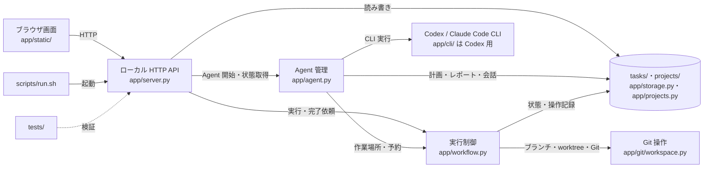
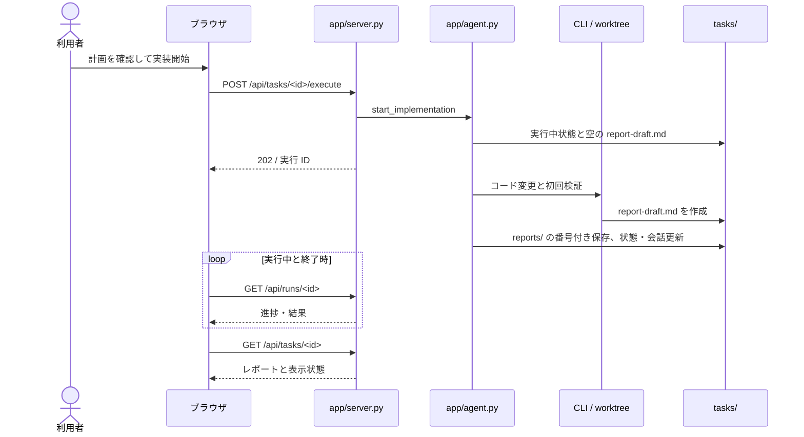
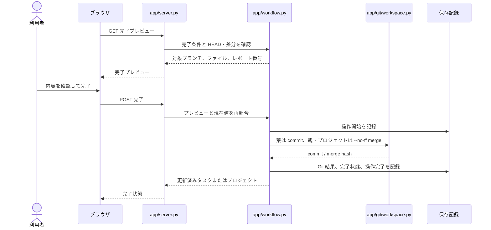
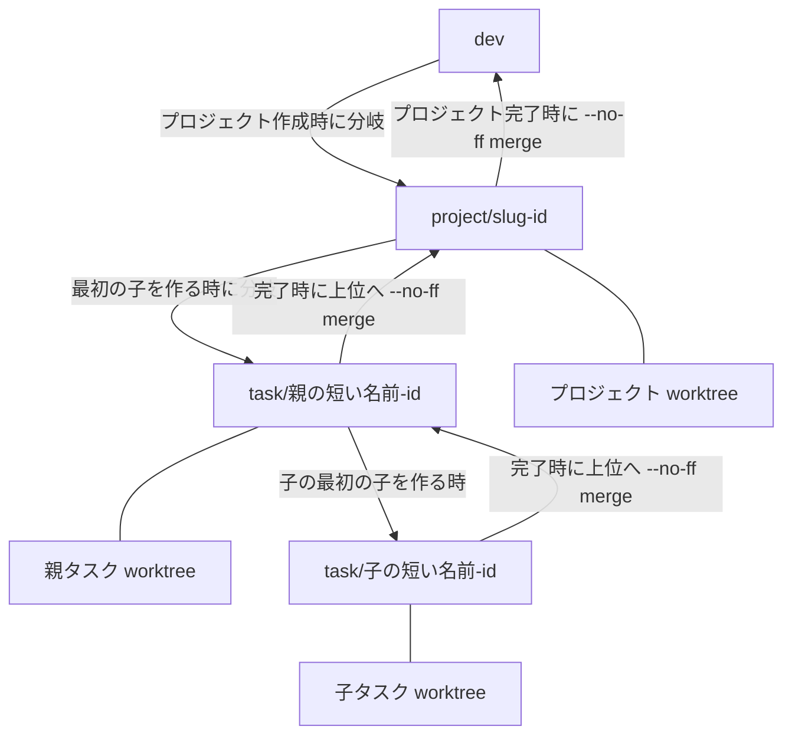

# 開発・システム設計ガイド

この文書は、現行のローカル GUI を更新する人向けに、画面操作から保存・Git までをたどる入口です。利用手順は[利用ガイド](user-guide.md)、Agent の実行規則は[研究開発スキル](../.codex/skills/research-workflow/README.md)と[手順本文](../.codex/skills/research-workflow/SKILL.md)を参照してください。将来案は現行仕様に含めません。

## 1. 対象範囲と全体像



ブラウザは `app/server.py` の HTTP API を呼びます。API は記録を読み書きし、Agent 実行を `app/agent.py`、承認された作成・完了操作を `app/workflow.py` に渡します。Agent は CLI を起動してタスクの記録に結果を書き、実行制御は Git と worktree を操作します。`scripts/` は起動、`tests/` は動作確認の補助です。

## 2. 構成要素と責務

| 要素 | 入力 | 出力・保存上の責務 |
| --- | --- | --- |
| `app/static/index.html`・`app.js`・`styles.css` | 操作、API 応答 | 画面表示、操作要求。一時的な選択・編集中内容・実行表示はブラウザ側。チャット欄の高さとプロジェクトごとのタスク一覧の開閉状態は `localStorage`。 |
| `app/server.py` | HTTP 要求 | JSON と静的ファイルを返す。`display_status` と実行 ID を応答に付ける。 |
| `app/workflow.py` | 承認済みの作成・完了要求 | プロジェクト・タスクの状態、Git 操作記録、ブランチ予約を更新。 |
| `app/agent.py`・`app/agent_stream.py` | 計画・実装・02・総括の要求、CLI イベント | CLI を起動し、チャット・レポート・実装状態を更新。実行中の進捗はサーバー内メモリ。 |
| `app/storage.py`・`app/projects.py` | タスク・プロジェクト情報 | `tasks/` と `projects/` の JSON・Markdown を読み書き。 |
| `app/git/workspace.py` | ブランチと対象パス | Git コマンド、worktree、コミット、`--no-ff` マージ。 |
| CLI 実行環境 `app/cli/` | Agent の指示・JSON Schema | Codex CLI を npm で固定。Claude Code CLI は別途導入。 |

ブラウザの一時状態や Agent の実行中表示と、ファイルに残るタスク状態は別です。進捗のメモリ記録はサーバー再起動後には残りません。 計画・レポート・チャットは画面で Markdown 表示され、資料はタスクごとに保存されます。`app/evidence.py` はアップロードを 100 MB までの許可形式に制限します。Codex のモデル候補は CLI の `model/list` から取得し、新しい Codex タスクの既定値は `gpt-6-sol` です。Claude Code は別途導入した CLI の設定を使います。

## 3. 代表操作の処理経路

`<id>` は対象の ID です。画面は `app/static/app.js`、API は `app/server.py`、処理順は `app/workflow.py` と `app/agent.py` で確認できます。

| 操作・前提 | 画面・HTTP メソッドと経路 | 処理担当 | 更新する記録／Git | 画面に戻る結果 |
| --- | --- | --- | --- | --- |
| プロジェクト作成 | 作成画面 → `POST /api/projects` | `WorkflowService.create_project` | `dev` からプロジェクトブランチと worktree、`project.json`、初回 `task.json` | 作成したプロジェクト、初回タスクを選択 |
| プロジェクト直下のタスク追加 | プロジェクト画面 → `POST /api/projects/<id>/tasks` | `WorkflowService.create_root_task` | プロジェクトブランチを共有し、子 `task.json` を保存 | 作成したタスク |
| 01 計画相談 | 01 チャット → `POST /api/tasks/<id>/chat` (`phase: plan`) | `AgentManager.start_chat` | `plan.md`、`chat_plan.json`、実装可否・分割案を `task.json` に保存 | 実行 ID、後に会話と実装可否を表示 |
| 計画原文の編集 | 計画編集 → `PATCH /api/tasks/<id>` | `storage.update_task` | `plan.md` と `task.json`、既存の実装可否を失効 | 更新した計画と状態 |
| 分割案を承認 | 提案カード → `POST /api/tasks/<id>/proposals/<proposal_id>/approve` | `WorkflowService.create_child` | 最初の子なら `task/<親の短い名前>-<id>` と worktree、子 `task.json`、親の分割案 | 作成した子タスク |
| 手動で子を作成 | 子作成画面 → `POST /api/tasks/<id>/children` | `WorkflowService.create_child` | 同上。提案承認記録はなし | 作成した子タスク |
| 実装と初回検証 | 確認後の実装ボタン → `POST /api/tasks/<id>/execute` | `AgentManager.start_implementation`・`_work` | 任意の `additional_instruction` はその回のプロンプトだけに追加する。worktree のコード、`report-draft.md` から `reports/0001.md` などへ保存、`task.json`・`chat_result.json`。この時点でコミットしない | 実行 ID と後続のレポート |
| 子タスクの並列実装 | 親の計画画面 → `POST /api/tasks/<id>/parallel-execute` | `AgentManager.start_parallel_children`・`WorkflowService.prepare_parallel_children` | 選択した計画済みの葉に個別ブランチと worktree を作成し、独立した Agent 実行を開始。親には未承認変更を入れない | 実行 ID の配列 |
| 実行確認 | 画面の更新 → `GET /api/runs/<id>`、`GET /api/tasks/<id>` | `AgentManager.get_run`・`Handler.present_task` | 読み取りのみ。実行履歴はメモリ内 | 進捗、完了結果、表示状態 |
| 02 追加検証・修正 | 02 チャット → `POST /api/tasks/<id>/chat` (`phase: result`) | `AgentManager.start_chat`・`_work` | 必要なら worktree のコード、結果が得られれば次の番号の `reports/`、`chat_result.json`・`task.json` | 実行 ID と新しい結果。結果がなければレポートは増やさない |
| 変更ファイルの差分確認 | タスク画面 → `GET /api/tasks/<id>/diff`、`?path=<ファイル>` | `WorkflowService.task_diff` | 読み取りのみ | 作業中の未コミット差分、完了後のコミット・マージ差分 |
| 資料追加 | 02 の資料選択 → `POST /api/tasks/<id>/evidence?name=...` | `app/evidence.py` の `save_evidence` | `tasks/<id>/evidence/` | 資料の情報と表示 |
| 葉タスクの完了 | 完了確認 → `GET /api/tasks/<id>/completion-preview`、確認後 `POST /api/tasks/<id>/complete` | `WorkflowService.completion_preview`・`complete_task` | 対象差分をコミット、`operations/`・`task.json` | 完了状態と commit hash |
| 並列実装した葉の完了 | 個別レビュー後に同じ完了 API | `WorkflowService.complete_task` | 子ブランチへコミットし、親へ `--no-ff` マージ。競合時はコミット済みの子ブランチを保持し、再度の完了操作で統合を試す | 完了状態と commit hash・merge hash |
| 親の総括 | 子が全て完了 → `POST /api/tasks/<id>/summary` | `AgentManager.start_summary` | 任意の `additional_instruction` はその回のプロンプトだけに追加する。総括レポートと根拠を `reports/`・`task.json` に保存。コード変更なし | 実行 ID と総括 |
| 親タスクの完了 | 総括確認 → `GET /api/tasks/<id>/completion-preview`、`POST /api/tasks/<id>/complete` | `WorkflowService.complete_task` | 親ブランチを上位へ `--no-ff` マージ、`operations/`・`task.json`、親 worktree とブランチを削除 | 完了状態と merge hash |
| プロジェクト完了 | 全タスク完了 → `GET /api/projects/<id>/completion-preview`、`POST /api/projects/<id>/complete` | `WorkflowService.project_preview`・`complete_project` | `dev` へ `--no-ff` マージ、`operations/`・`project.json`、プロジェクト worktree とブランチを削除 | 完了状態と merge hash |



実装開始時に作業ブランチを予約し、空の原稿を準備します。CLI の変更・検証後、Agent 管理が原稿を番号付きレポートへ移して状態を更新します。ブラウザは実行 ID を使って進捗を取得し、完了後にタスクを読み直します。Git コミットは別の完了操作です。

Agent が実装前に計画の変更を求めて停止した場合は、停止理由と 01 で計画書を再生成する案内を 02 のチャットに残します。



プレビュー後の確認で初めて Git 操作に進みます。葉は差分をコミットし、親は上位ブランチ、プロジェクトは `dev` へマージします。成功した Git 操作を記録し、状態を完了へ更新します。旧データ移行に限り、差分のない検証済み葉を履歴上の完了として扱う分岐があります。

## 4. タスクとプロジェクトの状態

| 保存値 (`task.json`) | 主な契機 | 画面案内との関係 |
| --- | --- | --- |
| `planning` | 作成直後、計画や CLI・モデルの変更で実装可否が失効 | 会話も計画もなければ「未着手」。相談履歴・質問に応じ「ユーザー待ち」。 |
| `ready` | Agent が現在の保存計画を実装可能と判定 | 「ユーザー待ち／実装を開始」。計画変更で `planning` に戻る。 |
| `implementing` | 実装または 02 のコード実行を開始 | 「実行中」。失敗後は可否に応じ `ready` または `planning`。 |
| `verifying` | レポートを保存、実装・検証が成功 | 「ユーザー待ち／検証結果を確認」。 |
| `completed` | ユーザー確認後の完了 API が成功 | 「完了済み」。 |

保存値は `tasks/<id>/task.json` にあり、表示値は `app/task_status.py` がチャット・実行中フラグ・子の状態から API 応答時に求めます。最初のタスクも子タスクと同じ行描画を使います。子が未完了の親は「進行中／子タスクの完了を待機」、全子が完了した親は総括またはマージを促します。画面側も開始直後の実行を一時的に「実行中」と表示し、所属プロジェクトにも実行中の状態を示します。

| 保存値 (`project.json`) | 契機 | 画面表示 |
| --- | --- | --- |
| `active` | 作成時 | 「進行中」。全タスク完了後は完了ボタンを利用できる。 |
| `completed` | `dev` へのマージ成功後 | 「完了済み」。 |

## 5. 記録と保存形式

| 保存先 | 主な作成・更新者と時点 | 主な読み手 |
| --- | --- | --- |
| `tasks/<id>/task.json` | GUI の保存処理。作成、計画判定、レポート追加、完了時 | API、Agent、画面 |
| `tasks/<id>/plan.md` | 01 Agent または画面の計画編集 | Agent、画面 |
| `tasks/<id>/chat_plan.json`・`chat_result.json` | Agent 管理が会話時に追加。初回利用時に作成 | API、画面 |
| `tasks/<id>/report-draft.md` | Agent が実行ごとに作成 | GUI のレポート保存処理。成功時に消去 |
| `tasks/<id>/reports/0001.md` 以降 | GUI の保存処理が原稿から追記 | API、画面、親の総括 |
| `tasks/<id>/evidence/`・`validation/` | 資料アップロードまたは Agent の検証 | 画面、Agent。`validation/` は必要時のみ |
| `projects/<id>/project.json` | GUI の保存処理。作成、名称・状態・ブランチ予約の変更時 | API、実行制御 |
| `projects/<id>/operations/*.json` | 実行制御。Git 操作の開始・成功・完了時 | 再起動時の照合処理 |

旧形式の `result.md` に内容があるタスクは、`app/storage.py` が最初のレポートとして読み込みます。既存記録の実値はここには掲載しません。`tasks/` と `projects/` は `.gitignore` の対象です。

## 6. Git ブランチと worktree



新規プロジェクトは `dev` を起点に専用ブランチと worktree を作ります。親に初めて子を作る時だけ親名を含む `task/<短い名前>-<id>` を作り、さらに階層が深い場合も同じ規則です。既存ブランチは改名しません。プロジェクト直下のタスクはプロジェクトブランチを共有します。通常の葉は所属する最も近い作業ブランチで変更し、完了時にその変更をコミットします。並列実装に選ばれた兄弟葉は個別ブランチで変更し、人の確認でコミットした後、別の確認で親へ `--no-ff` マージします。競合時はマージを abort して子ブランチとコミットを保持します。親とプロジェクトはユーザーの完了確認後に上位へマージし、統合したブランチと worktree を外します。Git 操作は `operations/` に記録され、サーバー起動時に未完了記録と Git の HEAD を照合します。既存データの移行経路は `app/workflow.py` の `migrate_legacy` と `acknowledge_migration` を確認してください。

## 7. Agent と画面の境界

| 段階 | Agent の担当 | GUI・利用者の担当 |
| --- | --- | --- |
| 01 計画 | `plan.md` 更新、実装可否・質問・分割案を JSON で返す | GUI が会話・判定・提案を保存。利用者が提案を承認して子を作る。 |
| 実装 | worktree でコード変更と初回検証、`report-draft.md` 作成、短い JSON 結論 | GUI が番号付きレポート・変更ファイル・状態を保存。利用者が結果を確認する。 |
| 02 検証 | 追加検証、必要なら修正・再検証。新しい結果があれば原稿を作る | GUI が新しいレポートを追加。利用者が追加依頼・完了判断を行う。 |
| 親の総括 | 子のレポートと commit を根拠に結果を整理。コード変更なし | GUI が総括を保存。利用者の確認後に GUI が Git マージする。 |
| 完了 | Git コミット・マージを実行しない | GUI がプレビューと再照合、Git 操作、`task.json` / `project.json` 更新を行う。 |

JSON 応答は画面の短いメッセージ・判定・提案に使い、検証本文は Markdown ファイルです。`task.json`、チャット、番号付きレポートの管理は GUI 側です。実行中は `GET /api/runs/<id>` を約 1.5 秒ごとに取得し、再表示時はタスク応答の `active_run_id` から復帰します。直近の作業履歴はメモリ内なのでサーバー再起動では保持されません。画面別の規則は[スキルの手順](../.codex/skills/research-workflow/SKILL.md)と[01・02 の指示](../.codex/skills/research-workflow/references/README.md)を確認してください。

## 8. 変更目的から対象を探す

| 変更目的 | 最初に読む場所 | 関連箇所 | 確認する操作／テスト | 更新する文書 |
| --- | --- | --- | --- | --- |
| 表示と画面操作 | `app/static/index.html`・`app.js`・`styles.css` | `app/server.py`、`app/task_status.py` | 代表操作を画面で確認、`tests/test_markdown.mjs` | `docs/user-guide.md`、画面例 |
| HTTP API | `app/server.py` | `app/workflow.py`、`app/storage.py` | 該当リクエスト、`tests/test_project_api.py` | 本ガイドの経路表 |
| 実行順と状態 | `app/workflow.py`、`app/task_status.py` | `app/agent.py`、`app/storage.py` | 01→実装→02→完了、`tests/test_workflow.py` | 本ガイドの時系列図・状態表 |
| Agent と CLI | `app/agent.py`、`.codex/README.md` | `app/agent_stream.py`、`app/cli/` | 実行状態、`tests/test_agent_stream.py` | `.codex/` の指示、本ガイド |
| タスク・プロジェクト保存 | `app/storage.py`、`app/projects.py` | `app/workflow.py` | レポート保存と旧形式、`tests/test_project_workflow.py` | 本ガイドの保存表 |
| Git と worktree | `app/git/workspace.py`、`app/workflow.py` | `app/projects.py` | 完了プレビュー、`tests/test_project_workflow.py` | 本ガイドのブランチ図・経路表 |
| 起動と依存 | `scripts/run.sh`、`pyproject.toml`、`uv.lock` | `app/cli/package.json` | 起動、`tests/README.md` のコマンド | ルート README、本ガイド |

各フォルダ固有の説明は [app](../app/README.md)、[Git](../app/git/README.md)、[画面](../app/static/README.md)、[起動](../scripts/README.md)、[テスト](../tests/README.md)、[Agent](../.codex/README.md) の README から追えます。

## 9. 開発環境と検証手順

Python 3.12 以降、`uv`、Node.js / npm、Git、`dev` ブランチを用意します。`pyproject.toml` は Python 依存を、`uv.lock` はその解決結果を管理します。Codex CLI は `app/cli/package.json` と lock ファイルで管理します。

```bash
uv sync --frozen
source .venv/bin/activate
npm ci --prefix app/cli
bash scripts/run.sh
```

`run.sh` は `.venv` を有効化して `uv sync --frozen --active` を実行し、Codex CLI がなければ npm で導入して `python -m app.server` を起動します。ブラウザの URL は `http://127.0.0.1:8765` です。CLI の認証とモデル利用権限は別途必要です。

更新時は次の順に確かめます。

1. 変更前に対象の画面操作、API 経路、保存ファイル、Git 差分を記録する。
2. 文書またはコードを更新し、変更対象と関連図表を合わせる。
3. `.venv` を有効化した端末で `python -m unittest discover -s tests -v`、Markdown 表示に関係する変更では `node tests/test_markdown.mjs` を実行する。
4. 該当する代表操作を画面で再確認する。Git 完了操作はテスト用リポジトリで確認する。
5. リンク、Mermaid、記載コマンド、README 案内と差分を確認する。

## 10. 文書更新と完了前の確認

| 変更内容 | 更新する文書 |
| --- | --- |
| UI・操作 | [利用ガイド](user-guide.md)、[画面例](screenshots/README.md)、必要なら本ガイドの経路表 |
| API・状態・保存・Git | 本ガイドの経路表・状態表・保存表・図、関連フォルダ README |
| 起動・依存 | 本ガイド第9章、[ルート README](../README.md)、[scripts README](../scripts/README.md) |
| Agent の作業境界 | 本ガイド第7章、[.codex README](../.codex/README.md)と[研究開発スキル](../.codex/skills/research-workflow/README.md) |

完了前には、図の矢印と実コード、保存状態と表示案内、相対リンク、コマンドの実在、資料に秘密情報や実タスクの値が含まれないことを確認します。検証を伴う操作は、レポートを見た利用者の完了確認まで Git に反映されません。タスク画面では変更ファイルごとの行差分を確認できます。グラフ表示は現行画面にありません。
