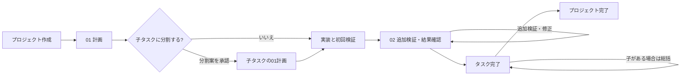
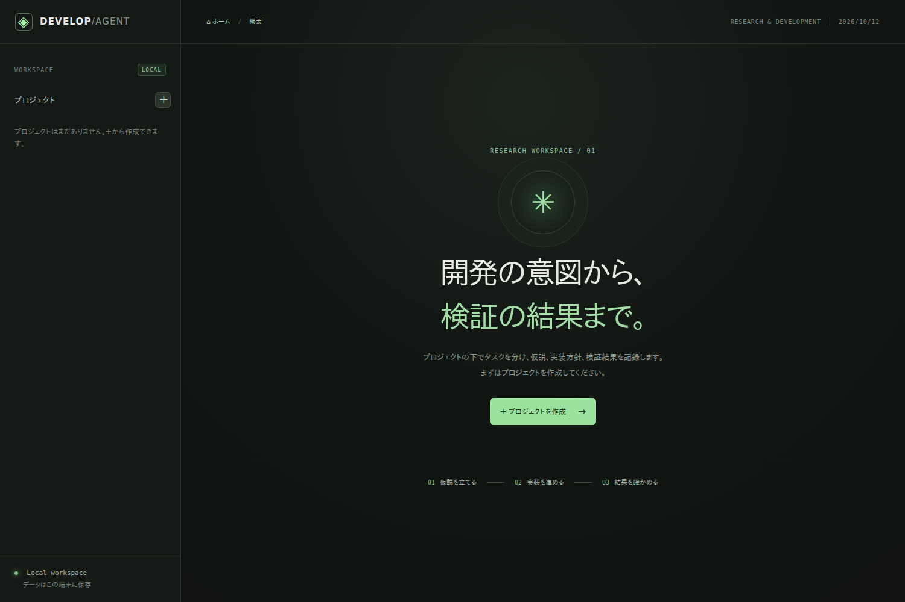
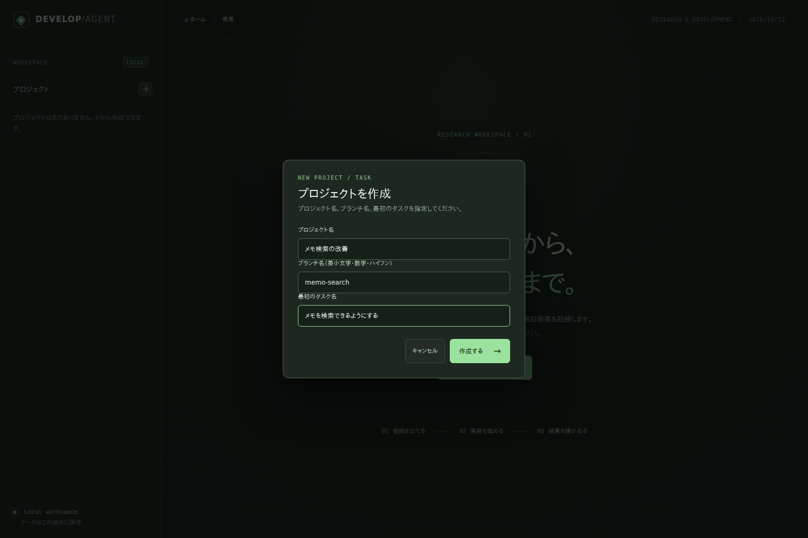
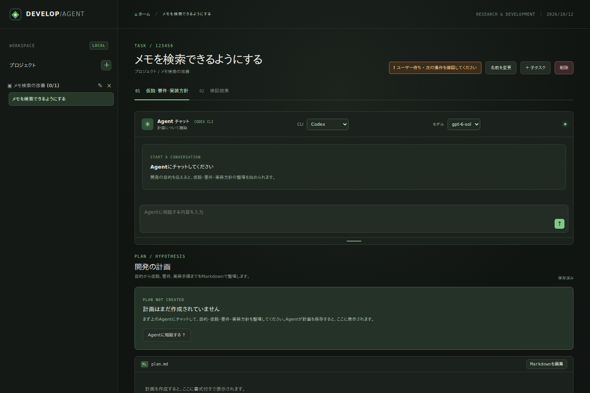
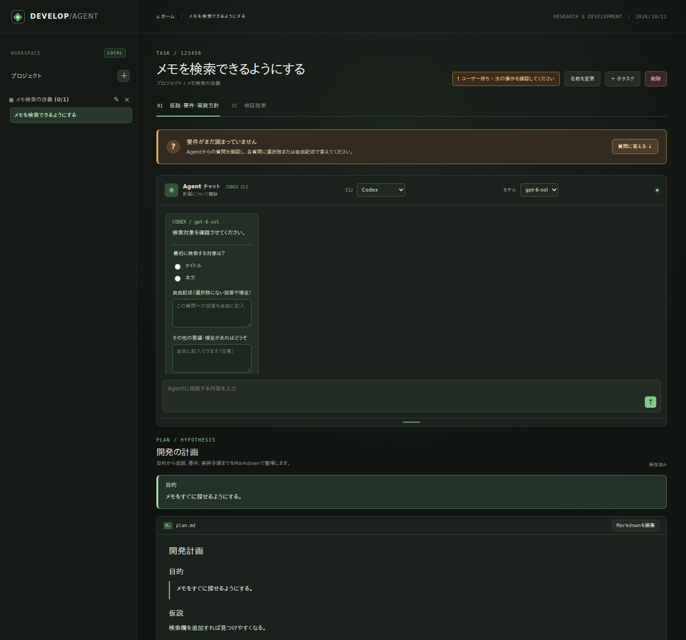
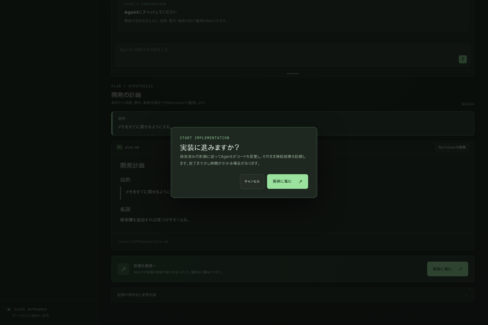
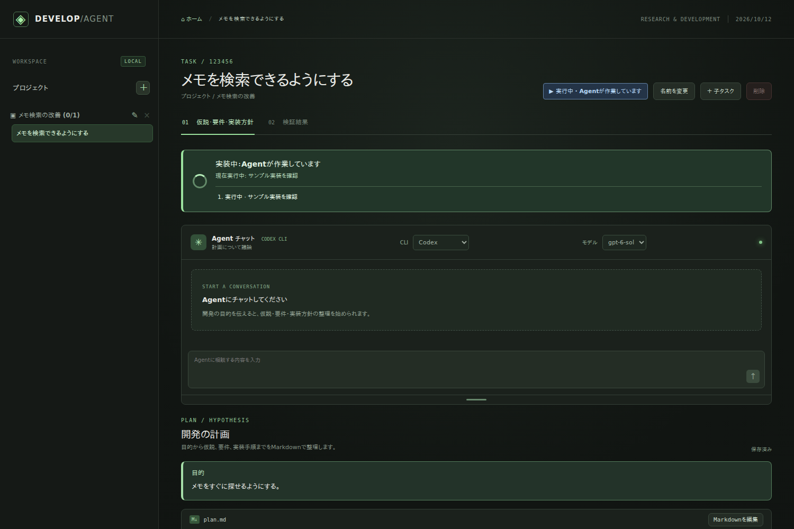
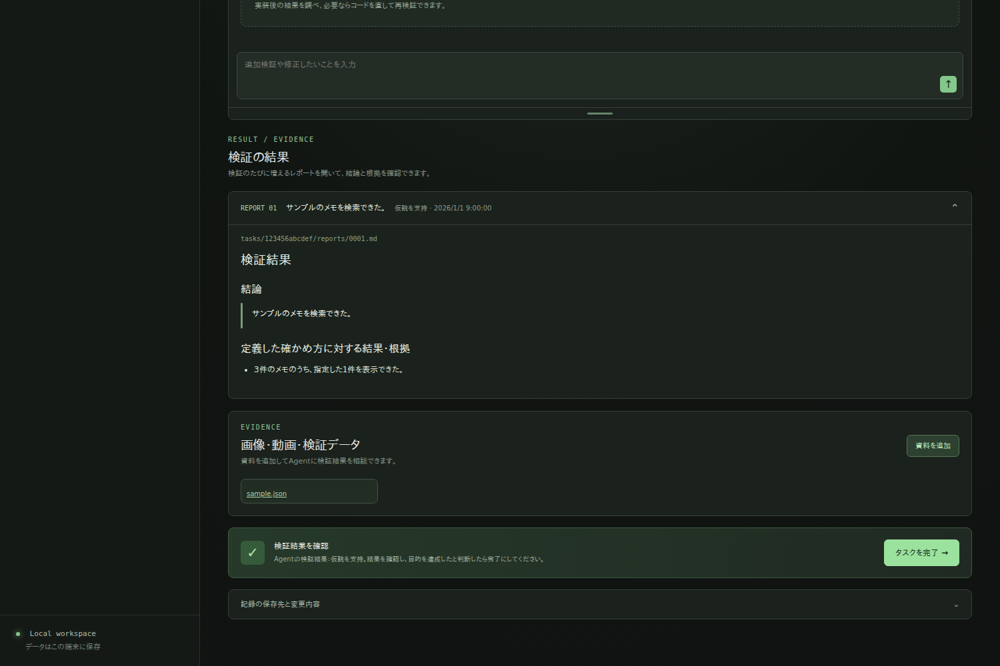

# 利用ガイド

このガイドは、初めて使う人が一つの研究開発タスクを作り、結果を確認するまでの手順です。画面例はすべて架空の「メモ検索の改善」を使っています。[画像の再現条件](screenshots/README.md)も参照してください。

## 利用の流れ

ブランチの仕組みは[システム設計](development-guide.md)を参照してください。

## このアプリでできること

プロジェクトの下に階層化したタスクを作り、目的、仮説、実装方針と検証結果をローカルに記録します。01 で計画を相談し、利用者が実装開始を確認すると Agent が実装と初回検証を続けて行います。02 ではレポートを読み、必要に応じて追加検証を依頼します。タスクとプロジェクトの完了は、結果を見た利用者が決めます。

左の一覧では、各プロジェクト名の左にある矢印で、そのプロジェクトのタスクだけを開閉できます。プロジェクト名を押すと詳細が開きます。開閉状態はブラウザに保存されます。プロジェクト名の下にはタスクの進捗が表示され、完了したプロジェクトには「完了済み」と表示されます。

*空のホーム。左上の＋または中央の「プロジェクトを作成」から始めます。[再現条件](screenshots/README.md#01-homepng)*

## 利用前の準備と起動

**前提状態:** Python 3.12 以降、`uv`、Node.js、npm、Git を利用でき、リポジトリの `dev` ブランチが存在する環境です。Codex を使う場合は、初回の npm パッケージ取得にネットワーク接続が必要です。CLI のログインとモデルの利用権限も必要です。Claude Code を選ぶ場合は、その CLI を別途導入・認証してください。

**操作:** リポジトリのルートで `bash scripts/run.sh` を実行し、ブラウザで `http://127.0.0.1:8765` を開きます。スクリプトが `uv sync --frozen` で `.venv` を準備して有効化し、必要ならアプリ専用 Codex CLI を `npm ci` で導入してサーバーを起動します。

**表示結果:** プロジェクトがなければ空のホームが表示されます。CLI が使えない場合も画面は開きますが、Agent チャットと実装開始は使えません。Codex のモデル一覧が出ない場合は画面を更新し、CLI の導入・ログイン・権限を確認してください。

**保存される記録:** 起動だけでは新しいタスク記録は作られません。Python 環境は `.venv/`、アプリ用 CLI は `app/cli/node_modules/` に入ります。

## プロジェクトと最初のタスクを作る

**前提状態:** ホームを開き、`dev` の未コミット変更を整理済みです。

**操作:** 中央の「＋ プロジェクトを作成」または左上の「新しいプロジェクト」を押します。「プロジェクト名」「ブランチ名（英小文字・数字・ハイフン）」「最初のタスク名」を入力して「作成する」を押します。最初のタスク名は空欄ならプロジェクト名になります。

*架空の名前を入力した作成ダイアログ。[再現条件](screenshots/README.md#02-createpng)*

**表示結果:** 最初のタスクの「01 仮説・要件・実装方針」が開き、左の一覧にプロジェクトとタスクが並びます。計画は未作成です。

*計画が空の最初のタスク。[再現条件](screenshots/README.md#03-taskpng)*

**保存される記録:** `projects/<id>/project.json` にプロジェクト、`tasks/<id>/task.json` と空の `plan.md` に最初のタスクが残ります。Git には `dev` からプロジェクト用ブランチが作られます。

## 01 計画を相談して保存する

**前提状態:** 最初のタスクの 01 画面で、CLI とモデルが利用可能です。

**操作:** 「Agent チャット」に目的と困りごとを送ります。質問が表示されたら、各質問の選択肢か「自由記述（選択肢にない回答や補足）」で回答し、「回答をAgentに送る」を押します。Agent の計画は下側にプレビューされます。手で直す場合は「Markdownを編集」を押し、編集後に「変更を保存」を押します。

*選択式質問と計画のプレビューを並べた例。[再現条件](screenshots/README.md#04-planpng)*

**表示結果:** 保存後は「保存済み」と表示されます。Agent が最新の保存計画を実装可能と判定すると「実装に進む」が使えるようになります。計画の文字数や手動保存だけでは有効になりません。Agent が「Agentからの分割案」を提示した場合は、内容を確認して承認すると子タスクが作られます。子タスクは同じ 01 の手順で計画します。最初の子を作ると、親タスク名を含む専用ブランチが作られます。

**保存される記録:** 計画は `tasks/<id>/plan.md`、01 の会話は `tasks/<id>/chat_plan.json` に残ります。実装可否の判定は `task.json` に記録されます。計画・CLI・モデルを変更すると判定は失効するため、Agent に再確認を依頼してください。分割案の承認前に子タスクは作られません。

## 実装を始める

**前提状態:** 子を持たないタスクの計画が保存済みで、Agent が実装可能と判定し、CLI とモデルが使える状態です。子を持つタスクでは実装ボタンを使わず、子タスクを進めます。

兄弟の子タスクを同時に実装する場合は、親の 01 計画画面で計画済みかつ未着手の子を二つ以上選び、「選択した子タスクを並列実行」を押します。確認画面では全タスクに共通する追加指示を任意で入力できます。選択した子だけに専用ブランチと worktree が作られ、Agent が同時に実装・検証します。結果は各子の 02 で個別に確認します。未承認の変更は親ブランチに入りません。

**操作:** 01 の「実装に進む」を押し、必要なら今回の実装への追加指示を入力して「実装に進む」を押します。追加指示はこの実行だけに適用され、保存済みの計画は変わりません。

*保存済み計画から実装を始める前の確認。[再現条件](screenshots/README.md#05-executepng)*

**表示結果:** チャット上部に「実装中：Agentが作業しています」と作業履歴が出ます。実装後に初回検証が続きます。画面更新後も実行状態を読み直し、終了後はタスクを開き直して 02 のレポートを確認できます。

*実行中の状態表示例。[再現条件](screenshots/README.md#06-runningpng)*

**保存される記録:** 実装状態は `task.json`、結果が得られた初回検証は `reports/0001.md`、資料は `evidence/` に残ります。実装開始時点ではタスクの完了や Git コミットは行われません。

## 02 検証結果と資料を見る

**前提状態:** 対象タスクの「02 検証結果」を開きます。実装・検証が終わるとレポートが表示されます。

**操作:** `REPORT 01` などの見出しを開いて結論と本文を読みます。複数回の結果は新しい順に並び、見出しから切り替えられます。「画像・動画・検証データ」では資料名やサムネイルを押して開き、「資料を追加」で手元の対応ファイルを添付できます。追加検証や修正が必要な葉タスクでは、02 の Agent チャットに依頼を送ります。

*架空の初回検証レポートと資料領域。[再現条件](screenshots/README.md#07-resultpng)*

**表示結果:** 新しい結果が得られると次の番号のレポートが増えます。結果が得られなかった実行では新しいレポートが増えないことがあります。検証結論が「判断保留」「仮説を支持せず」でも、内容を確認して次の判断をしてください。

**保存される記録:** 各回の本文は `tasks/<id>/reports/0001.md` 以降に追加され、02 の会話は `chat_result.json`、アップロード資料は `evidence/` に保存されます。以前のレポートは残ります。

## タスクとプロジェクトを完了する

### 葉タスク

**前提状態:** 実装が成功し、保存済みの検証レポートとコミット対象の変更があり、Agent が実行中ではありません。

**操作:** 02 で結果を確認し、「タスクを完了」を押します。確認画面に示されたコミット先と対象ファイルを確認し、提案されたコミットメッセージを必要に応じて編集してから「タスクを完了」を押します。空白だけのメッセージでは完了できません。

以前の確認画面の例は[画面例の一覧](screenshots/README.md#08-completepng)にあります。

**表示結果:** 通常のタスクは「完了済み」になります。**保存される記録:** タスクの完了状態とコミット情報が `task.json` に残り、確認した変更が編集後のメッセージでタスクの作業ブランチへコミットされます。編集内容は完了前の検証レポートには反映されません。

並列実装した子は、完了操作で専用ブランチへコミットし、続けて親へマージして完了します。競合した場合はマージを中止し、子のコミットとブランチを保持します。競合を解決した後は「親ブランチへ統合」から再実行してください。

### 子を持つタスク

**前提状態:** すべての子タスクが完了しています。**操作:** 親の 02 で「総括レポートを作成」を押し、必要なら今回の総括への追加指示を入力して開始します。追加指示はこの総括だけに適用されます。最新の総括を確認してから「タスクを完了」を押し、マージ先と対象を確認して承認します。**表示結果:** 親が「完了済み」になります。**保存される記録:** 総括が親の `reports/` に追加され、親ブランチの変更が上位ブランチへマージされます。子の結果が変わった場合は最新の総括が必要です。

### プロジェクト

**前提状態:** プロジェクト内の全タスクが完了しています。**操作:** 左のプロジェクトを選び、「承認して dev にマージ」を押し、確認画面のブランチと対象を見て承認します。**表示結果:** プロジェクトが「完了済み」になります。**保存される記録:** `projects/<id>/project.json` に完了状態が残り、プロジェクトの変更が `dev` にマージされます。

## 保存された記録を確認する

**前提状態:** タスクの詳細画面を開いています。**操作:** 「記録の保存先と変更内容」を開き、確認したいファイル名を押します。**表示結果:** `tasks/<id>/` の場所と、変更ファイルごとの追加・削除行が表示されます。作業中は未コミット差分、完了後はそのタスクのコミットまたはマージ差分を確認できます。**保存される記録:** この表示操作自体は記録を変更しません。

`tasks/<id>/plan.md` は計画、`reports/` は番号付きの検証結果と総括、`evidence/` は画像・動画・測定データ、`chat_plan.json` と `chat_result.json` は会話です。`projects/<id>/` はプロジェクトの状態と Git 操作の記録です。`tasks/` と `projects/` は端末内の作業記録として Git 管理から除外され、実装したコードは作業ブランチで管理されます。詳細は[システム設計](development-guide.md)を参照してください。

## 操作上の制約と困ったとき

- CLI が見つからない、未ログイン、モデルを選べない場合は、導入・認証・権限を確認して画面を更新してください。Codex CLI の初回取得にはネットワーク接続が要ります。
- Agent 実行中は編集、削除、完了などが制限されます。画面更新後も実行状態を確認してください。計画・CLI・モデルを変えたら実装可否を Agent に再判定してもらいます。
- タスクの「削除」は確認画面の対象と子タスク数を見て承認してください。計画、会話、レポート、資料は復元できません。プロジェクトの削除も全タスク記録と作業ブランチが対象になり、Git 履歴や未コミット変更がある場合は拒否されます。
